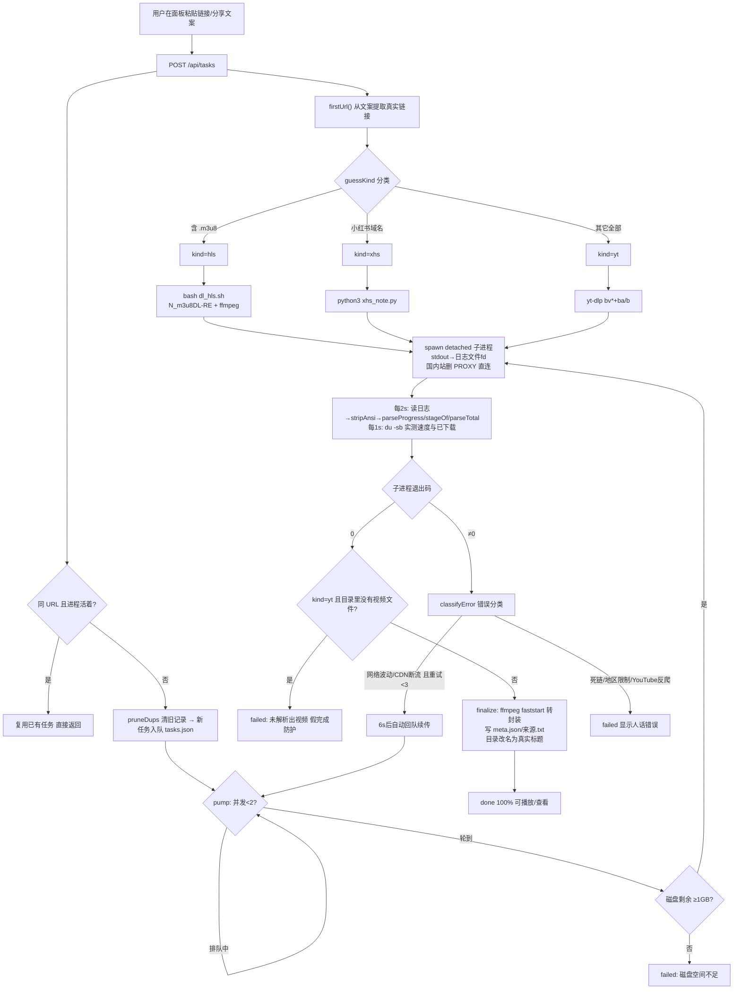
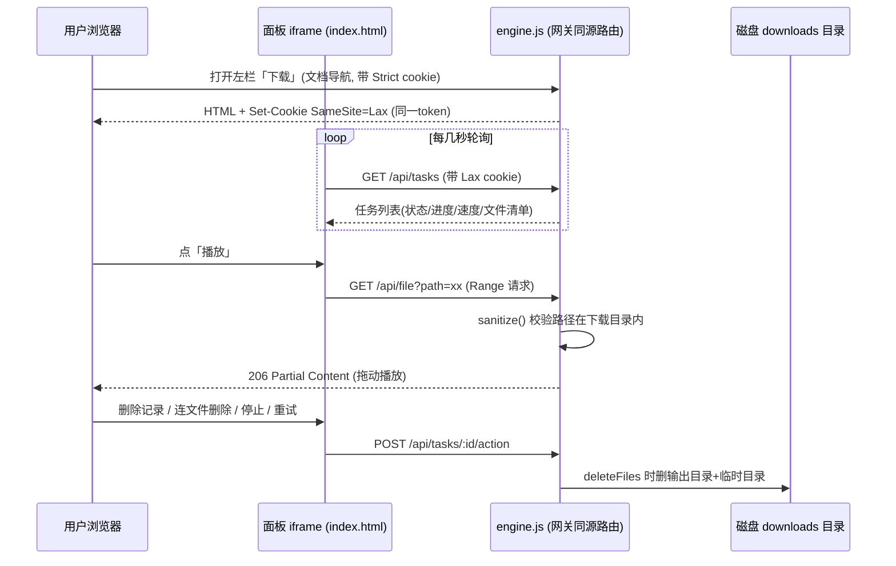
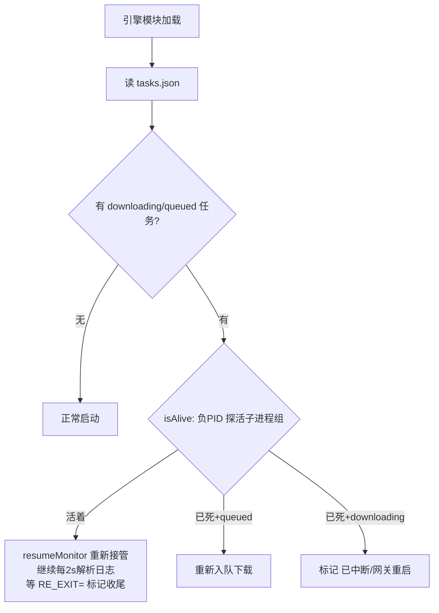

# dsh-downloader 原理与业务流程

> 版本 v0.2.0 · MIT 协议 · 2026-11-04 整理
> 源码：`~/code/dsh-plugin/dsh-downloader/`（本机运行副本在 `~/.dsh/profiles/desktop/dsh-downloader/`）

## 一、它是什么

DSH（DeepSeek Harness）左侧栏的「下载管理器」面板插件：粘贴网址即可下载——小红书笔记（图/视频/正文/评论）、m3u8/HLS 直链、B站/抖音/快手/TikTok/微博等全平台视频；面板可看任务状态与进度、删除记录或连文件删除、展开查看内容并直接在线播放视频。

## 二、总体架构原理

插件是 DSH profile 的一个 bundle（`package.json` 声明 `dsh.bundle.patch` + `dsh.client.platform=web`），分宿主/客户端两半：

```
┌─ DSH 网关（宿主 Node 进程）────────────────────────────┐
│  lib/index.js  宿主壳：webServer.register 挂前缀路由     │
│    /dsh-downloader        → 返回 public/index.html      │
│    /dsh-downloader/api/*  → engine.js handler           │
│  lib/engine.js 引擎：任务队列 + 子进程下载 + 状态解析     │
│    └ spawn 子进程: yt-dlp / xhs_note.py / dl_hls.sh      │
│         └ dl_hls.sh 内部再调 N_m3u8DL-RE + ffmpeg        │
│  数据目录 ~/.dsh/dl-manager/（config.json/tasks.json/logs）│
└─────────────────────────────────────────────────────────┘
┌─ 浏览器（Web GUI）─────────────────────────────────────┐
│  lib/client.js 注册左栏「下载」导航 + 主面板 iframe       │
│  public/index.html iframe 内容：同源 fetch 调 api/*      │
└─────────────────────────────────────────────────────────┘
```

关键设计决策：

1. **壳/引擎分离 + mtime 热加载**：`index.js` 只做路由注册（改动需重启网关）；全部业务逻辑在 `engine.js`，宿主壳按文件 mtime 判断，变了就 `import('engine.js?t=' + mtime)` 重新加载——改下载逻辑存盘即生效，不用重启。UI（index.html）与下载脚本（scripts/）每次请求/任务现读，天然热生效。
2. **同源路由而非独立端口**：面板 iframe 直接 fetch `/dsh-downloader/...`，与 DSH 网关同源，鉴权走网关 cookie，无需 CORS 与 apiProxy。还有一处补丁：网关鉴权 cookie 是 SameSite=Strict，iframe 里的 fetch 带不上 → 面板 HTML 和 /api/tasks 响应里用同一 token 重发一份 SameSite=Lax 的 cookie，让面板轮询实时刷新。
3. **不自己解析网页，外包给成熟工具**：宿主只起进程 + 读日志。三条下载管线按 URL 特征路由：
   - URL 含 `.m3u8` → `bash scripts/dl_hls.sh`（内部 N_m3u8DL-RE 下载 + ffmpeg 合并转 faststart；已处理"PNG 头伪装 TS"分段）
   - 小红书域名 → `python3 scripts/xhs_note.py`（抓图/视频/正文/评论）
   - 其它一切 → `yt-dlp`（`--format bv*+ba/b`，输出目录按标题命名；自己能解析 B站/抖音/快手短链等）
4. **进度 = 日志解析，非 IPC**：子进程 stdout/stderr 直接重定向到日志文件 fd（不走管道，避免 detached 进程管道缓冲卡死）。宿主每 2 秒读日志，正则提取：`parseProgress`（yt-dlp 的 `[download] xx% of` / RE 的 `xx%` 行）、`parseTotal`（总大小，严格整行匹配防误抓）、`stageOf`（解析中/下载中/合并转码/已完成）、`stripAnsi` 先剥 ANSI 颜色。
5. **速度 = 磁盘实测**：每 1 秒 `du -sb` 下载目录+临时目录，差值平滑（0.5/0.5 指数）得全局速度；每任务再单独量其输出目录真实字节，避免估算失真。
6. **并发队列 + 断流自动续传**：`CONCURRENCY=2` 的 pump 循环；失败先过 `classifyError` 人话分类——网络波动/CDN 断流 → 可重试，6 秒后自动回队（最多 `MAX_AUTO_RETRY=3` 次，yt-dlp/RE 自带断点续传）；死链/地区限制/YouTube 反爬 → 直接失败不空转。
7. **进程级容错**：磁盘预检（剩余 <1GB 拒绝开始）；`spawn detached` + 负 PID 信号杀整个进程组；网关重启/热重载后扫描 tasks.json——子进程还活着的 `resumeMonitor` 重新接管（读日志、等 `RE_EXIT=` 收尾），死进程才标"已中断"，不误杀在线下载。
8. **国内直连策略**：B站/抖音等的视频 CDN 走代理会卡死——国内站点白名单域名从子进程环境里删掉 `*_PROXY` 并写 `NO_PROXY`，外站才走代理。
9. **任务去重**：同 URL 且进程活着 → 复用不新建；同 URL 的 stopped/failed/done 旧记录 → 移除（pruneDups）；done 但文件已被人删 → 列表自动过滤。
10. **安全边界**：`/api/file?path=` 用 `sanitize()` 把路径 resolve 后校验必须在下载目录内（防目录穿越）；支持 HTTP Range（206），视频可直接在浏览器拖动播放。

## 三、模块职责

| 文件 | 职责 | 改动生效方式 |
|---|---|---|
| lib/index.js | 宿主壳：注册 /dsh-downloader 前缀路由、注入 public/scripts 路径、按 mtime 热加载引擎 | 重启网关 |
| lib/engine.js | 引擎（~600 行）：配置加载、任务队列、spawn 下载、日志解析进度/速度、错误分类重试、HTTP API | 存盘即热加载 |
| lib/client.js | 客户端：左栏「下载」导航行 + 主面板（iframe 指向路由） | 重启网关 |
| public/index.html | 面板 UI：分类标签/分页/设置页/播放 | 刷新即生效 |
| scripts/dl_hls.sh | HLS 管线：N_m3u8DL-RE → ffmpeg faststart 转封装 | 下次任务生效 |
| scripts/xhs_note.py | 小红书管线：笔记图文/视频/正文/评论落盘 | 下次任务生效 |
| cordis.patch.yml | 向 DSH bundle 树插入插件声明 | 重启网关 |

## 四、HTTP API

| 方法+路径 | 说明 |
|---|---|
| GET /dsh-downloader/ | 面板 HTML（注入版本号 + 重发 Lax 鉴权 cookie） |
| GET /api/tasks | 任务列表（顺带清理文件已删的 done 任务） |
| POST /api/tasks | 新建 `{url, name?}`：抽取分享文案里的真实链接 → guessKind 分类 → 去重 → 入队 |
| GET /api/tasks/:id | 单任务详情（含文件清单） |
| POST /api/tasks/:id/action | `{action: delete(仅记录) / deleteFiles(连文件) / retry(新建同任务) / stop(杀进程组)}` |
| GET /api/config / POST /api/config | 读/写设置（写 config.json 后立即 reload） |
| GET /api/log/:id | 该任务日志末 40 行（排错） |
| GET /api/file?path= | 读下载目录内文件，Range 支持，视频在线播 |

## 五、业务流程图

### 5.1 主流程：粘贴链接 → 下载完成



### 5.2 面板查看与播放



### 5.3 网关重启/引擎热重载后的任务接管



## 六、配置体系（优先级 config.json > 环境变量 > 默认）

| 设置项 | 环境变量 | 本机默认值 |
|---|---|---|
| 数据目录 | DLM_DATA | ~/.dsh/dl-manager（本机为 macOS 适配过，原版写死 /data/.dsh/dl-manager） |
| 下载目录 | DLM_DOWNLOAD_DIR | <数据目录>/downloads |
| 临时目录 | DLM_TMP | <数据目录>/tmp_down |
| 工具 PATH 前缀 | DLM_BIN_PATH | 本机已配 ~/.local/bin:/opt/homebrew/bin |
| yt-dlp / ffmpeg / ffprobe / python3 / N_m3u8DL-RE | YTDLP / FFMPEG / FFPROBE / PYTHON3 / RE_BIN | 裸命令名走 PATH，或设置页填绝对路径 |

## 七、二次开发要点

- 加平台：engine.js `run()` 里按 kind 分发处（约 268–282 行）加分支；多数站 yt-dlp 已支持，无需改代码
- 加 API：engine.js `handler()` 顺序路由，加 case 即可
- 改 UI：public/index.html 单文件，同源 fetch
- 热调试：改 engine.js/index.html/scripts 存盘即生效；只有 index.js/client.js 需重启网关
- 已知限制：YouTube 需登录 cookie（反爬），插件未内置；原版路径为 Docker 设计，桌面端注意 DLM_DATA
